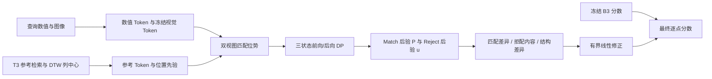

# 参考条件下的异常保持对齐：结构审查与重构

本文件说明正式模型的结构设计，不用评价指标选择结构。旧版 Checkpoint 的张量结构与新版不同；新版使用独立的 Checkpoint 目录。冻结 B3 的完整视觉、原始数值与已训练数值证据保持原评分实现。

本方法只保留两个可陈述的机制：**参考条件后验对齐**（T3 负责候选与位置先验，三状态 DP 负责唯一的软对应）和**异常保持证据分解**（Match 解释的差异、Reject 保留的内容、局部结构变化）。最终修正只是这六个统计量的有界线性读出。

## 旧版冗余与处理

| 旧计算 | 问题 | 新职责 |
|---|---|---|
| T3 constrained-DTW 列路径之后先 gather 已变形参考，再围绕对角线做第二次软对齐 | 两次路径的坐标系不同；第二次的位移相对已变形列，而不是原参考列 | T3 只选参考窗口并给出原参考列中的先验中心；三状态 DP 直接对原参考 Token 求唯一的模型后验 |
| 查询/参考各一套跨视图 MLP，另有两套结构投影 MLP | 数值和视觉 Token 已各自归一化，额外的成对投影难以区分模态作用 | 两种视图分别计算余弦匹配，取无参数平均；结构差异在后验下单独计算 |
| Query Reject、Reference Skip 各有一套独立的 unary MLP | unary 状态分数不取决于对应参考；等长且固定双端点使两种 gap 的总数相等 | 一个共享的可学习 gap 成本；拒配由整条单调路径的匹配质量竞争产生 |
| 未匹配向量、对齐参考向量、拒配概率、匹配可靠性和学习的可靠性网络同时送入 Transformer 头 | 未匹配向量含拒配质量，可靠性又包含行匹配质量，证据重复且不易归因 | 每个视图保留匹配差异、拒配内容差异及结构差异三个有界统计量；可靠性直接等于行匹配质量，不另学习门控 |
| 训练时 Warp 后逐位置比较未变形的修正量 | 已知时间映射未作用在比较目标上 | 将原修正量按同一映射变形，再比较对应位置 |

## 重构后的信息流

1. 冻结 B3 输出逐点基础分数 `S_B3`；已有 T3 产物给查询窗口选一个不重叠参考窗口 `r`，并提供 DTW 列中心 `c_i`。推理直接读取该冻结产物，不重复检索和 DTW。
2. 数值编码器 `N` 和冻结的视觉列投影 `V` 分别产生单位范数的 14 个查询/原参考 Token：`n_i, v_i, n'_j, v'_j`。不先用 `c_i` 重排参考 Token。
3. 匹配位势 `M_ij = (〈n_i,n'_j〉 + 〈v_i,v'_j〉)/2 - softplus(a)(j-c_i)^2`。Query Reject 与 Reference Skip 共享位势 `G = -softplus(g)`。T3 提供位置先验，匹配质量由当前两视图决定。
4. 从 `(0,0)` 到 `(T,T)` 的前向/后向动态规划，对 Match `(i,j)→(i+1,j+1)`、Query Reject `(i,j)→(i+1,j)`、Reference Skip `(i,j)→(i,j+1)` 求路径分布。`P_ij` 是 Match 边缘概率，`u_i` 和 `s_j` 分别是 Reject 和 Skip 边缘概率。严格满足 `Σ_j P_ij + u_i = 1`、`Σ_i P_ij + s_j = 1`。模型可靠性 `p_i = Σ_j P_ij = 1-u_i`，不另训练门控。
5. 证据直接在**未重排的原参考坐标**中取后验期望。令 `d(x,y)=(1-〈x,y〉)/2`，`Δx_i=x_i-x_{i-1}` 且首项为零。对每个视图 `x∈{n,v}`：

   - 匹配差异 `M^x_i = Σ_j P_ij d(x_i,x'_j)`；
   - 拒配内容差异 `U^x_i = u_i · (1/T)Σ_j d(x_i,x'_j)`，将被拒配的查询特征与完整参考的统计分布比较，不强制指派某一参考位置；
   - 一阶结构差异 `D^x_i = Σ_j P_ij ||Δx_i-Δx'_j||²/16 + u_i||Δx_i||²/4`，被拒配位置仍保留查询自身的局部变化。

   六个统计量均处于 `[0,1]`。Match 与 Reject 的证据分开计算；拒配概率本身不直接作为异常分数，只有被拒配的内容与变化才进入读出。Reference Skip 通过路径竞争影响 `P` 和 `u`，不再作为重复评分输入。
6. 零初始化线性读出 `d_i = tanh(w·[M^n_i,M^v_i,U^n_i,U^v_i,D^n_i,D^v_i]+b)`，沿用原有逐点恢复和无标签中位数校准，最终 `S_final = S_B3 + 0.05·calibrated(d)`。零初始化时严格回到 B3。

## 训练目标与梯度

训练沿用无标签合成扰动和冻结 B3 反事实分数。`L_rank` 在扰动位置提高最终逐点分数，困难样本权重由冻结 B3 响应决定；`L_unchanged` 在未扰动位置约束**最终分数变化**；`L_warp` 约束模型修正满足已知可逆时间映射 `d(Wq,r,Wc) ≈ W d(q,r,c)`。三项分别对应敏感性、局部性、时间变形稳定性。保持既有 `1 / 0.5 / 0.5` 权重和 0.05 融合系数，避免把权重改动与结构改动混淆。

对齐器的两个参数、数值编码器和读出头都从最终逐点检测目标接收梯度。视觉列投影、T3 和 B3 冻结。训练与推理共用同一模型前向、T3 窗口 ID/列中心、逐点恢复及校准函数。

## 迁移边界

| 项目 | 旧正式实现 | 重构实现 |
|---|---|---|
| T3 | 每次推理重新运行检索与 DTW，随后采样参考列 | 读取冻结 T3 产物；原参考窗口及列中心直接进入模型 |
| 可微对齐 | 预变形参考上的第二次路径，独立 Reject/Skip MLP | 原参考上的唯一后验路径，共享 gap 成本 |
| 视觉与数值交互 | 拼接后多组投影 | 两视图独立相似度与后验差异 |
| 评分 | 六组宽向量、两个标量和 Transformer | 六个有定义的标量与线性读出 |
| Warp 目标 | 同下标比较 | 按已知映射比较 |
| Checkpoint | 旧张量结构 | 新结构，严格加载；可只迁移旧数值编码器 |

可训练参数由 `2,059,973` 减至 `1,059,945`（减少 `1,000,028`，约 `48.55%`）。保留的数值编码器占 `1,059,936`；新对齐器只有 2 个标量参数，证据读出只有 7 个参数。冻结视觉投影仍作为状态字典缓冲区保存，不计入可训练参数。

这次重构改变模型结构与输出，不能把旧版逐点结果或旧版 Checkpoint 当作新版复现。现有评测协议保持相同，但结构判断不使用评价标签。
